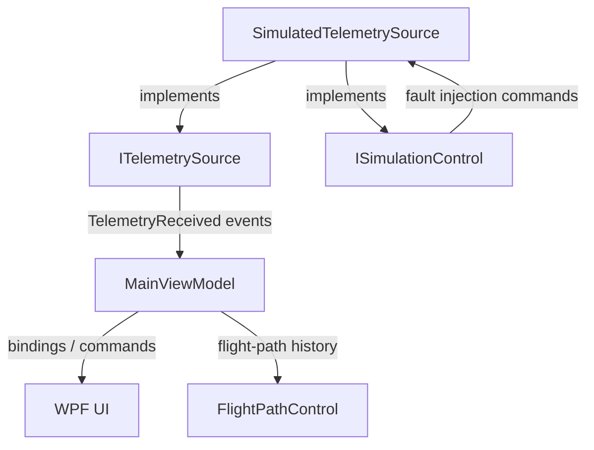

# Telemetry Dashboard

A lightweight aircraft telemetry and operator-monitoring desktop application built with **C#**, **.NET 8**, **WPF**, and **MVVM**.

The project simulates a live aircraft telemetry stream, visualizes flight state and position, monitors system health, and supports controlled fault injection for testing degraded conditions such as telemetry loss, GPS failure, link degradation, battery faults, overspeed, and high descent rates.

The application was designed as a compact operator-facing systems demo with an emphasis on **separation of concerns, state ownership, testability, and clear presentation of abnormal conditions**.

---

## Features

- Live simulated aircraft telemetry at approximately **10 Hz**
- Tactical flight-path visualization with current aircraft heading
- Primary flight data:
  - Altitude
  - Airspeed
  - Ground speed
  - Heading
  - Vertical speed
  - Flight mode
- System-health monitoring:
  - Battery charge
  - Data-link quality
  - GPS satellite count
  - Arm state
  - Position
- Connection and receive-state monitoring
  - `ONLINE` / `OFFLINE`
  - `LIVE`
  - elapsed receive age
  - stale telemetry detection
- Severity-based health indication
  - Normal
  - Caution
  - Critical
- Timestamped event log
- Fault-injection controls for abnormal operating conditions
- Bounded and downsampled flight-path history
- Dependency injection through `Microsoft.Extensions.Hosting`
- Automated tests with xUnit

---

## Architecture

The application separates telemetry acquisition, simulation controls, presentation state, and rendering.



### Telemetry flow

```text
SimulatedTelemetrySource
        |
        | TelemetryReceived
        v
   ITelemetrySource
        |
        v
   MainViewModel
        |
        | WPF bindings
        v
      MainWindow
```

`MainWindow` does not know whether telemetry originates from a simulator, network connection, serial device, or another source. It consumes state exposed by the ViewModel.

A future source such as `UdpTelemetrySource` or `SerialTelemetrySource` could implement `ITelemetrySource` without requiring the UI to be rewritten.

---

## Project Structure

```text
telemetry_dashboard/
├── TelemetryDashboard.App/
│   ├── Controls/
│   │   └── FlightPathControl.cs
│   ├── Resources/
│   │   ├── Colors.xaml
│   │   └── Styles.xaml
│   ├── ViewModels/
│   │   └── MainViewModel.cs
│   ├── App.xaml
│   ├── App.xaml.cs
│   ├── MainWindow.xaml
│   └── MainWindow.xaml.cs
│
├── TelemetryDashboard.Core/
│   ├── Events/
│   ├── Interfaces/
│   │   ├── ITelemetrySource.cs
│   │   └── ISimulationControl.cs
│   └── Models/
│       ├── AlertSeverity.cs
│       ├── FlightMode.cs
│       ├── FlightPathPoint.cs
│       ├── FlightTelemetry.cs
│       ├── HealthLevel.cs
│       └── TelemetryAlert.cs
│
├── TelemetryDashboard.Infrastructure/
│   └── Telemetry/
│       └── SimulatedTelemetrySource.cs
│
├── TelemetryDashboard.Tests/
│   └── SimulatedTelemetrySourceTests.cs
│
└── TelemetryDashboard.sln
```

## Screenshot


---

## Design Decisions

### `ITelemetrySource`

Telemetry acquisition is exposed through a small interface:

```csharp
public interface ITelemetrySource
{
    event EventHandler<TelemetryReceivedEventArgs>? TelemetryReceived;
    bool IsRunning { get; }

    Task StartAsync();
    Task StopAsync();
}
```

This keeps the presentation layer independent of the telemetry transport or data source.

### `ISimulationControl`

Fault injection is intentionally separated from the normal telemetry contract.

```text
ITelemetrySource
    normal application-facing telemetry behavior

ISimulationControl
    simulator-specific testing and fault injection
```

This prevents test/demo controls from becoming part of the general telemetry-source abstraction.

### Shared simulator instance

Dependency injection exposes one `SimulatedTelemetrySource` instance through both interfaces:

```text
                  SimulatedTelemetrySource
                    /                 \
          ITelemetrySource       ISimulationControl
```

This ensures that commands and telemetry events operate on the same simulation state.

### UI thread handling

Telemetry is generated outside the WPF UI thread. Incoming telemetry is marshalled through the WPF dispatcher before updating bindable ViewModel state.

This avoids cross-thread access to WPF-owned objects while allowing telemetry generation to run independently from UI rendering.

### Immutable telemetry snapshots

Each telemetry update is represented as a `FlightTelemetry` record. The ViewModel receives a complete snapshot rather than reading mutable simulator state directly.

### Bounded flight-path history

Telemetry arrives at approximately **10 Hz**, while flight-path points are sampled less frequently and capped at **300 points**.

This provides a smooth live display without allowing the history collection to grow indefinitely.

---

## Simulated Flight Behavior

The simulator advances through several flight phases:

```text
Takeoff
  ↓
Climb
  ↓
Cruise
  ↓
Loiter
  ↓
Return To Home
  ↓
Landing
```

Flight state is generated coherently rather than by independently randomizing each telemetry field. Heading, position, altitude, airspeed, ground speed, vertical speed, and flight mode evolve together.

During loiter, the aircraft continuously turns. During return-to-home and landing phases, heading is calculated toward the stored home position.

---

## Fault Injection

The dashboard includes operator-accessible controls for introducing abnormal conditions into the simulation.

| Interrupt | Behavior |
| --- | --- |
| **RX Loss** | Stops telemetry delivery while the simulator continues running internally |
| **Degrade Link** | Drives reported data-link quality toward a degraded level |
| **Low Battery** | Overrides battery charge toward a caution-level value |
| **Critical Battery** | Overrides battery charge toward a critical-level value |
| **GPS Loss** | Reports zero satellites and freezes the reported position while the simulated aircraft continues moving |
| **High Descent** | Forces a high negative vertical speed and corresponding altitude loss |
| **Overspeed** | Raises airspeed and ground speed above nominal simulated values |
| **Restore** | Clears active injected conditions and returns the simulation toward nominal behavior |

Injected metrics are visually identified in the UI so the operator can distinguish deliberate interference from ordinary telemetry behavior.

---

## Connection vs. Telemetry Freshness

The application deliberately treats source connection state and telemetry freshness as different concepts.

For example, during an injected receive loss:

```text
LINK // ONLINE
RX   // STALE 3.2s
```

The telemetry source is still running, but the ViewModel has not received a recent telemetry update.

This distinction allows the interface to represent several different failure conditions:

```text
Source offline
    !=
Source online but receiving no telemetry
    !=
Telemetry arriving with invalid/degraded sensor data
```

---

## Health Monitoring

Health state is derived from the reported telemetry rather than directly from the fault-injection button that was pressed.

### Battery

| Charge | State |
| --- | --- |
| `> 30%` | Normal |
| `15–30%` | Caution |
| `< 15%` | Critical |

### Data Link

| Link Quality | State |
| --- | --- |
| `> 75%` | Normal |
| `50–75%` | Caution |
| `< 50%` | Critical |

### GPS

| Satellites | State |
| --- | --- |
| `8+` | Normal |
| `1–7` | Caution |
| `0` | Critical |

The UI uses these derived states to change telemetry-value color independently from simulation-interrupt indicators.

---

## Event Log

The event log records meaningful transitions and test actions rather than logging every telemetry frame.

Examples:

```text
20:42:04  Info      TELEMETRY CONNECTED
20:42:18  Caution   LINK DEGRADATION INJECTED
20:42:19  Caution   DATA LINK DEGRADED
20:42:21  Critical  DATA LINK CRITICAL
20:42:28  Info      DATA LINK NOMINAL
20:42:41  Critical  GPS SIGNAL LOST
20:42:47  Info      GPS SIGNAL NOMINAL
```

Health-state baselines prevent the same alert from being generated repeatedly at the telemetry update rate.

---

## Testing

The test project uses **xUnit**.

Current automated coverage verifies:

1. `StartAsync()` marks the telemetry source as running.
2. `StopAsync()` marks the telemetry source as stopped.
3. Starting the simulator produces telemetry.
4. Injected GPS loss reports zero GPS satellites while telemetry continues.
5. Injected RX loss temporarily suppresses telemetry without stopping the telemetry source.

Run the complete test suite with:

```bash
dotnet test
```

---

## Requirements

- Windows
- .NET 8 SDK

WPF is Windows-specific, so the application must be run on Windows.

---

## Build and Run

From the solution root:

```bash
dotnet restore
dotnet build
dotnet run --project ./TelemetryDashboard.App/TelemetryDashboard.App.csproj
```

Run tests with:

```bash
dotnet test
```

---

## Technology

- C#
- .NET 8
- WPF
- XAML
- MVVM
- CommunityToolkit.Mvvm
- Microsoft.Extensions.Hosting
- Microsoft.Extensions.DependencyInjection
- xUnit

---

## Areas Demonstrated

This project is intended to demonstrate practical desktop application engineering rather than only visual UI work.

Key areas include:

- event-driven application architecture
- WPF data binding and MVVM
- asynchronous background work
- WPF dispatcher/thread affinity
- dependency injection
- interface-based separation of concerns
- state ownership
- custom rendering
- simulated hardware/system telemetry
- abnormal-condition handling
- bounded real-time data history
- automated behavioral testing

---

## Possible Extensions

The current simulator is intentionally self-contained. Logical future extensions include:

- UDP telemetry input
- serial telemetry input
- configurable telemetry update rates
- recorded telemetry playback
- exportable event logs
- additional operator alert thresholds
- persisted application settings
- richer telemetry history graphs

These additions could be implemented without replacing the existing ViewModel/UI architecture because telemetry acquisition is abstracted behind `ITelemetrySource`.
